<div align="center">


# BaaDash

**把文件交给队列，把屏幕留给内容。**

免费、开源的桌面下载管理器 · Windows · macOS · Linux

[](https://github.com/Suckmysheeep/BaaDash/releases/latest)
[](#下载安装)
[](#开发与构建)
[](LICENSE)

<br>

<picture>
  <source media="(prefers-color-scheme: dark)" srcset="docs/assets/zh-cn/main-dark.png">
  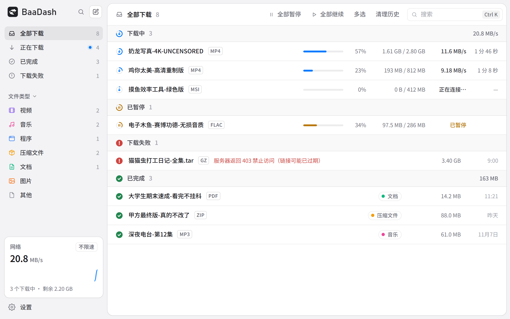
</picture>

[功能](#功能) · [下载安装](#下载安装) · [浏览器扩展](#浏览器扩展) · [界面预览](#界面预览) · [开发与构建](#开发与构建) · [更新记录](CHANGELOG.md)

</div>

---

BaaDash 是一个中文优先的桌面下载管理器，基于 Rust 与 Tauri 2，脱胎于 [SwiftDL](https://github.com/harshsinghsv/swiftdl) 并独立维护。

它做三件事：**把下载做扎实**（多连接、断点续传、校验失败不硬拼）、**让网页入口安静**（嗅探、视频浮层、图片浮层各自可控）、**把任务管理做顺手**（批量操作、分类整理、分享文字批量导入）。

## 功能

| 下载更从容 | 网页更安静 | 管理更顺手 |
| --- | --- | --- |
| 多连接与动态分段 | 嗅探与浮层分别控制 | 多选、全选与批量操作 |
| 暂停、续传与失败重试 | 视频入口自动隐藏 | 按类型与状态整理 |
| 并发任务与全局限速 | 图片浮层默认关闭 | 清理记录默认保留文件 |
| 分段与长度校验 | 单个网站独立设置 | 深浅主题与命令面板 |

### 多连接下载与断点续传

- 对支持 HTTP Range 的服务器多连接下载，动态把剩余分段分配给空闲连接；不支持时回落单连接。
- 暂停、继续、失败重试、全局限速与同时下载数量均可配置。
- 下载前确认文件信息与保存目录；下载中查看速度、进度和连接状态。
- 校验分段响应范围、续传记录与已知文件长度，遇到不一致时停止或重新下载，避免直接拼接错误内容。

<div align="center">
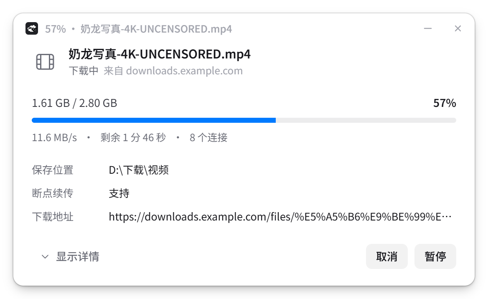
</div>

> 多连接不能突破实际带宽，速度取决于服务器、网络与磁盘。续传能否生效取决于服务器支持与文件是否变更；重要文件建议核对发布方提供的校验值。

### 嗅探可以灵敏，但不能吵闹

**BaaDash 下载助手**把普通下载接管、资源嗅探和网页浮层拆成独立开关：

| 选项 | 默认 | 用途 |
| --- | --- | --- |
| 接管浏览器下载 | 开启 | 将普通下载交给桌面应用 |
| 视频／音频资源嗅探 | 开启 | 检测页面加载的媒体资源；关闭后清除已发现列表 |
| 视频下载浮层 | 开启 | 鼠标进入后延迟出现，静止约 2 秒自动隐藏 |
| 图片下载浮层 | 关闭 | 按需开启，或只对指定网站开启 |

- 视频浮层关闭后，仍可从扩展弹窗主动查看已检测的资源。
- 排除播放器封面、视频覆盖区域及常见导航／logo 图片，减少误出现与按钮重叠。
- 全屏播放时默认安静，可在视频右上角唤出下载入口。
- 保留图片右键下载、当前页面图片收集与单站点停用。
- 按住 Alt 点击链接，可临时交给浏览器自行下载。

<div align="center">
<picture>
  <source media="(prefers-color-scheme: dark)" srcset="docs/assets/zh-cn/extension-dark.png">
  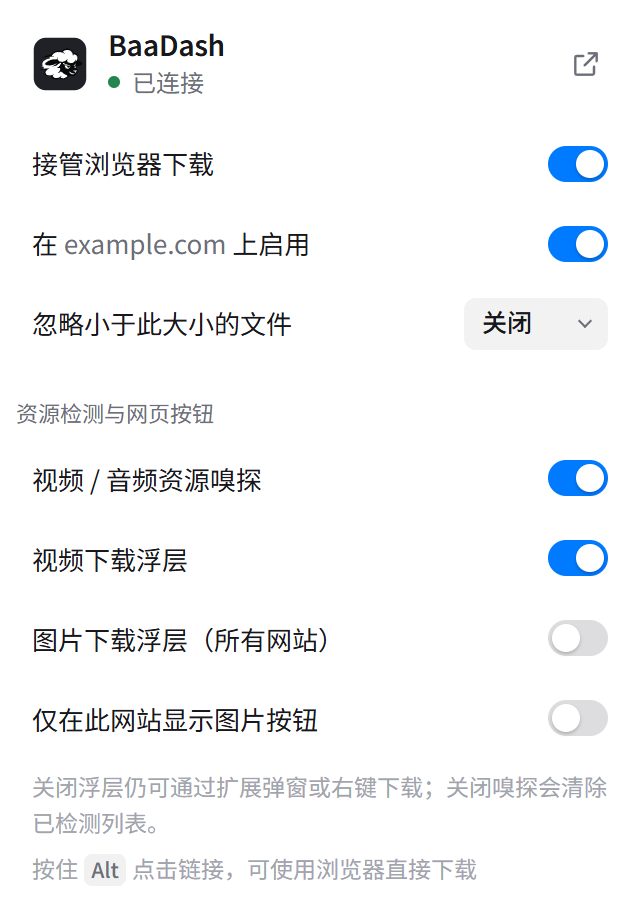
</picture>
</div>

### 一项任务，或一整个列表

点击「多选」进入管理模式，也支持 Ctrl / Cmd 多选、Shift 连选与全选当前列表，可批量暂停、继续、重试或移除。

「清理历史」只处理当前视图中的已完成与失败记录，默认保留已下载文件及失败任务临时数据；正在下载的视图提供任务管理，不使用含义模糊的「一键清空」。取消未完成任务会明确提示临时数据的处理方式。

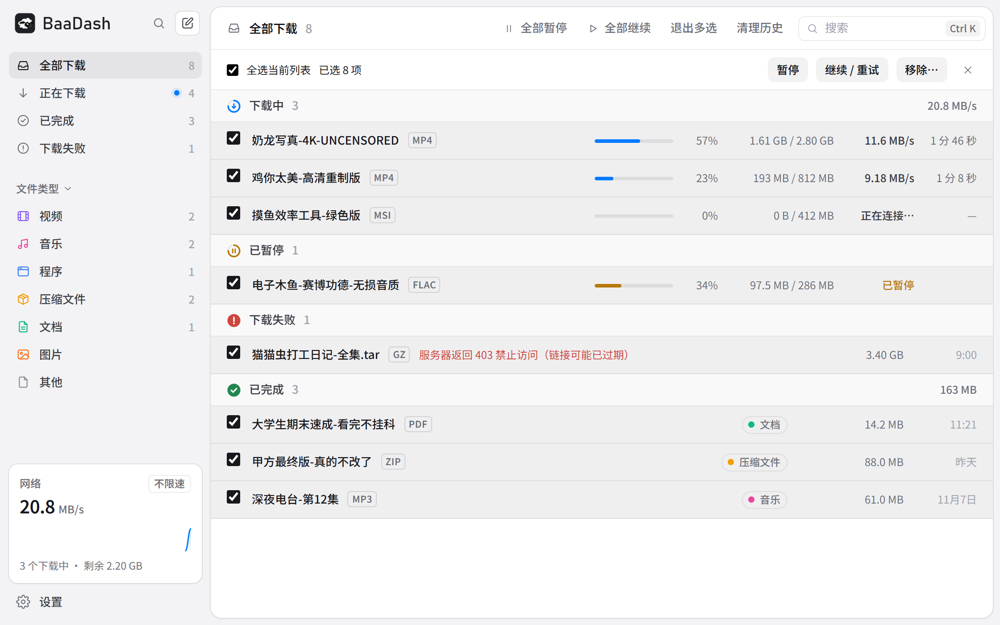

### 从分享文字到下载队列

粘贴多个链接，也可以粘贴包含链接的一整段分享文字。BaaDash 自动提取 HTTP / HTTPS 地址并去重，普通文件可选择立即开始或稍后下载。

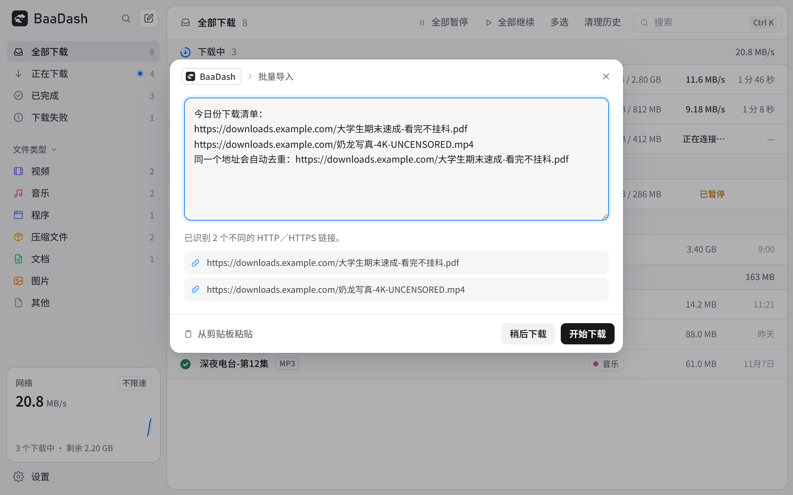

### 视频、图片与动图

- 支持可解析站点的清晰度选择、HLS / DASH 流媒体，以及 yt-dlp、FFmpeg 集成。
- 普通视频可在下载后另存 GIF，支持片段、尺寸、帧率与颜色设置，保留原视频。
- 可收集当前页面已加载的图片，支持当前 Pixiv 静态作品及当前 ugoira 动图。
- 支持 BitTorrent 种子和磁力链接。

<div align="center">
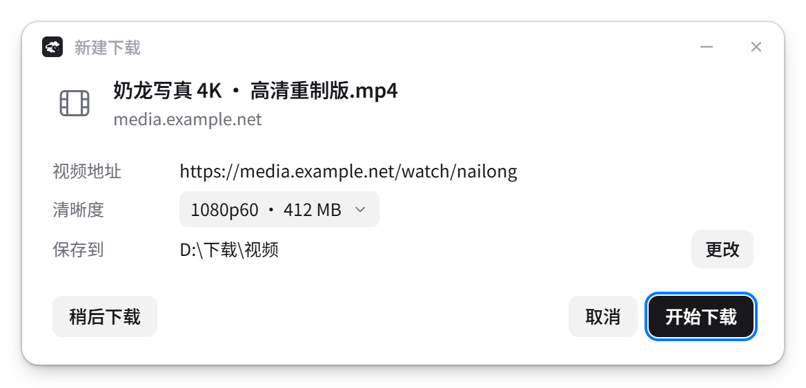
</div>

图片收集仅限当前页面或当前作品，不翻页、不抓取作者全部作品。站点能力取决于访问权限、会话与服务器策略；不支持 DRM，不承诺绕过登录、会员或其他限制。请仅下载你有权保存的内容。

## 下载安装

前往 [**GitHub Releases**](https://github.com/Suckmysheeep/BaaDash/releases/latest) 选择对应平台的安装包。

| 平台 | 文件 | 说明 |
| --- | --- | --- |
| Windows 10 / 11（64 位） | `BaaDash_*_x64-setup.exe` | 当前用户安装，无需管理员权限 |
| macOS | `BaaDash_*_universal.dmg` | Apple 芯片与 Intel 通用 |
| Linux | `.AppImage` · `.deb` · `.rpm` | 按发行版选择 |

Windows 安装包暂未做代码签名，SmartScreen 可能提示「发布者未知」。请确认下载来源为本仓库 Releases，再走「更多信息 → 仍要运行」。

## 浏览器扩展

扩展统一名称为 **BaaDash 下载助手**，支持 Chrome、Edge、Brave、Vivaldi、Chromium 与 Firefox 140+。

### Chromium 系浏览器

1. 打开桌面应用，进入「设置 → 浏览器」，打开应用附带的扩展文件夹。
2. 在扩展管理页开启「开发者模式」，选择「加载已解压的扩展程序」。
3. 加载该文件夹，打开扩展弹窗确认连接状态。
4. 按习惯分别设置下载接管、嗅探与网页浮层。

Chrome 的管理页是 `chrome://extensions`，Edge 是 `edge://extensions`。建议加载应用附带的原文件夹，方便随后续更新保持一致。

### Firefox

Firefox 需要 140 及以上版本（扩展使用 `data_collection_permissions` 声明），安装方式与 Chromium 系不同，目前有两条路径：

1. **应用内引导**：在「设置 → 浏览器」点击 Firefox，应用会打开 Firefox 附加组件页，按页面提示安装。该条目与此前的中文分支共用同一个扩展 ID（`swiftdl@harshhh.me`），因此能被 BaaDash 的原生消息主机识别。
2. **本地安装**：从 Releases 下载 `baadash-firefox.xpi`，在 `about:debugging` → 「此 Firefox」→「临时载入附加组件」中选择该文件。未签名的附加组件在浏览器重启后失效，仅适合自测与验证。

| 浏览器 | 发行包 | 安装方式 |
| --- | --- | --- |
| Chromium 系 | `baadash-extension.zip` | 加载已解压的扩展程序 |
| Firefox | `baadash-firefox.xpi` | 附加组件页安装，或 `about:debugging` 临时载入 |

原生消息主机按扩展 ID 白名单校验（Chromium 为 `knmfjbmojepkdiflnckpfjimfmjfcbgh`，Firefox 为 `swiftdl@harshhh.me`），换用其他来源的扩展不会被识别。扩展必须配合桌面应用使用；只看到按钮不代表已成功接管下载。

## 界面预览

<details>
<summary><b>浅色主题、命令面板与设置</b></summary>


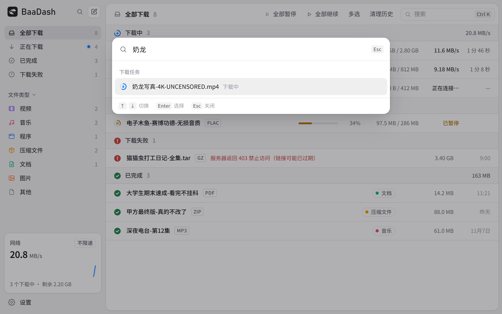

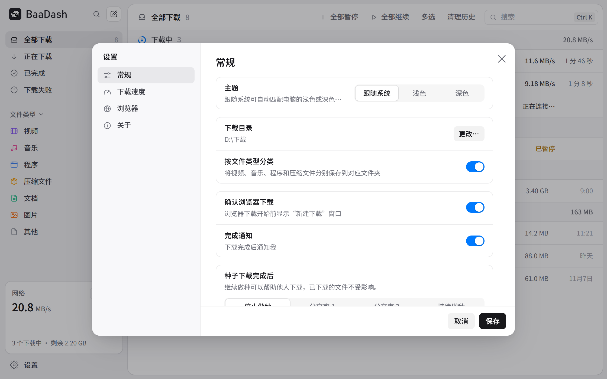

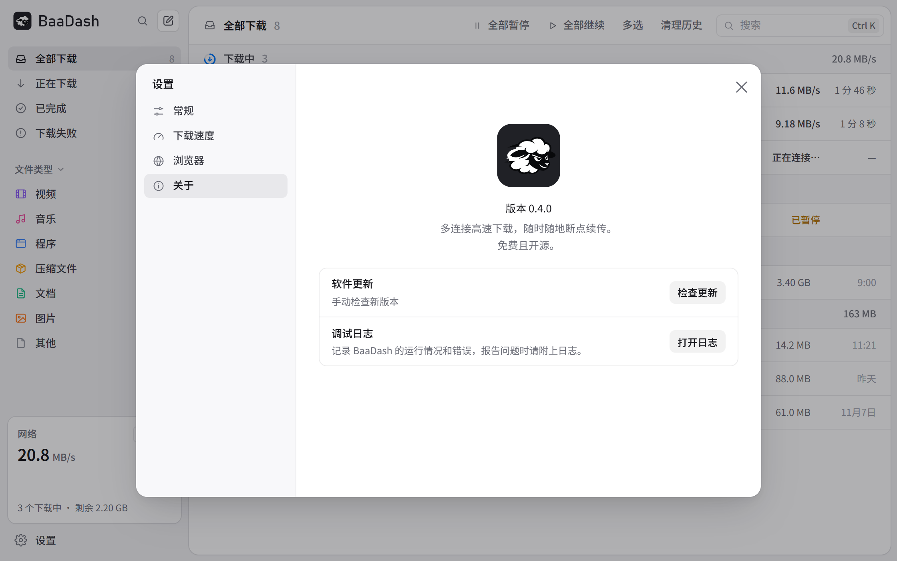

</details>

<details>
<summary><b>浏览器集成与下载前确认</b></summary>

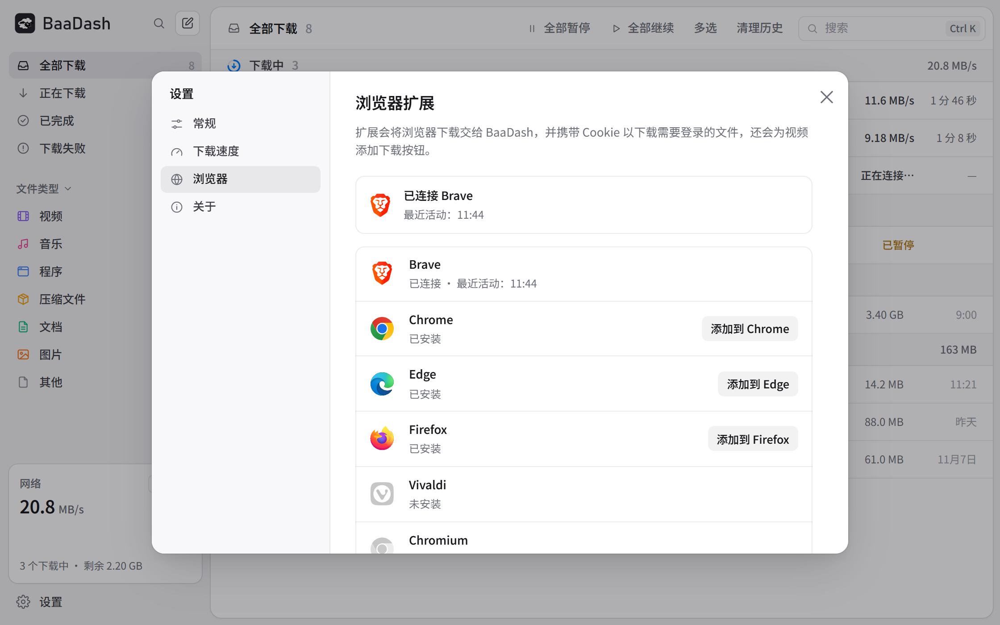

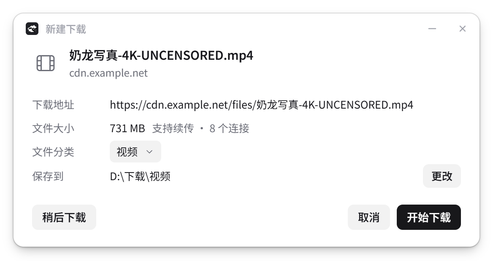

</details>

> 演示任务沿用项目原有的玩梗命名；所有文件名、链接、速度与进度均为模拟数据，图片由当前界面重新渲染，不代表真实资源、实际测速或站点专用下载能力。

## 使用提示

- 设置的各标签页均可通过右上角 ×、取消或 Esc 关闭；未保存的主题预览会恢复。
- 在「设置 → 关于」手动检查更新，查看最新版本或失败原因；后台自动检查同时保留。
- `Ctrl / Cmd + K` 命令面板，`Ctrl / Cmd + N` 新建下载，`Ctrl / Cmd + A` 全选当前列表。
- 清理记录默认不删除文件；取消未完成下载前请留意临时数据提示。
- 保存任务或设置失败时会提示，并记录调试日志。

## 开发与构建

需要 Rust、Node.js 22+，以及 [Tauri 2 平台依赖](https://v2.tauri.app/start/prerequisites/)。

```sh
git clone https://github.com/Suckmysheeep/BaaDash.git
cd BaaDash
npm ci --prefix app
npm run build --prefix app
cargo test --workspace
cargo install tauri-cli --version "^2" --locked
cd app/src-tauri
cargo tauri dev
```

构建当前平台安装包时，在 `app/src-tauri` 中执行 `cargo tauri build`。

资源生成与界面验证：

```sh
npm ci --prefix tools/brand
npm run build --prefix tools/brand
npm run check --prefix tools/brand
npm ci --prefix tools/ui
npm run test --prefix tools/ui
npm run screenshots --prefix tools/ui
```

界面测试需要 Chrome / Chromium，可通过 `CHROME` 环境变量指定路径。截图基于 `app/dist`，修改界面后请先重新构建。浏览器 API 模拟测试不能替代真实原生接管与安装升级测试，验收边界见 [验收记录](docs/LOCAL-ACCEPTANCE.md)。

<details>
<summary><b>目录结构</b></summary>

| 路径 | 内容 |
| --- | --- |
| `crates/engine` | 分段下载、续传、限速 |
| `crates/cli` | 命令行前端 |
| `app/src-tauri` | 桌面窗口、任务管理、系统集成 |
| `app/ui` | TypeScript 界面与演示后端 |
| `extension` | BaaDash 下载助手 |
| `site` | 官网介绍与下载说明 |
| `docs/assets` | 品牌资源与界面展示图 |
| `tools/brand` | SVG、PNG、ICO、ICNS、BMP 生成与校验 |
| `tools/ui` | 交互测试与演示图重拍 |

</details>

## 反馈与贡献

遇到问题请在 [Issues](https://github.com/Suckmysheeep/BaaDash/issues) 提供系统版本、软件版本、复现步骤与调试日志。功能建议与修复欢迎提交 PR，流程见 [CONTRIBUTING](CONTRIBUTING.md)；安全问题请按 [SECURITY](SECURITY.md) 私密报告。版本历史见 [CHANGELOG](CHANGELOG.md)，重立项之前的开发记录见 [历史更新日志](docs/CHANGELOG-archive.md)。

## 许可证与致谢

- 源代码使用 [MIT 许可证](LICENSE)，保留上游版权声明。
- 感谢原始项目 [harshsinghsv/swiftdl](https://github.com/harshsinghsv/swiftdl) 及其贡献者。BaaDash 独立维护，不代表上游作者背书。
- Noto Sans SC 使用 [SIL Open Font License](app/ui/public/fonts/OFL.txt)，随应用分发。
- yt-dlp、FFmpeg 及其他依赖遵循各自许可证。
